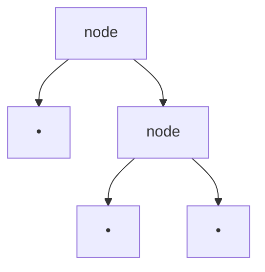
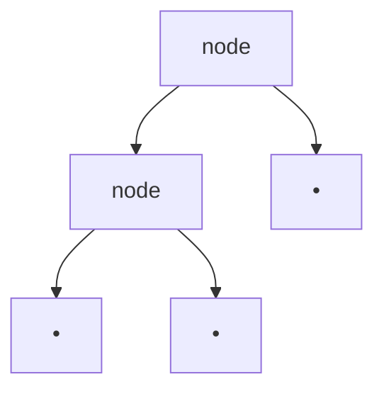

**Modelling Computer Systems** #CS117 

##### Section 8.1: What does 'inductively defined' even mean?
Some sets are infinite, so you can't list their members. 
Writing $\{0, 1, 2, 3, ...\}$ relies on the reader guessing what "..." means.
An inductive definition replaces the "..." with exact rules.

Every inductive definition has **three clauses:**
- **Basis clause:** the starting elements that are in the set without any conditions.
- **Inductive clause:** how to build new elements from ones you already have.
- **Extremal clause:** nothing else is in the set. Only things you can build using the first two clauses count.

**Key concepts**
Here's an example, with the natural numbers $\mathbb{N}$:
1. $0\in\mathbb{N}$
2. If $n\in\mathbb{N},\text{then }n+1\in\mathbb{N}$
3. Nothing else is in $\mathbb{N}$

>**💡Knowledge Check**
> Why does the extremal clause mean that $-1\notin\mathbb{N}$?
> *$-1$ isn't added by the basis clause, since that only gives 0.
> For the inductive clause to add it, we'd need $-1\in\mathbb{N}$ first, which would need $-3$, and so on forever.
> That chain never reaches 0. Every element the clauses build starts at 0 and only ever goes up, so it's $\geq0$*. By the extremal clause, nothing else is in $\mathbb{N}$, so $-1\notin\mathbb{N}$. ✅

**Exercise**
Write a three-clause definition of the even natural numbers $\{0,2,4,\dots\}$
Then write one for the odd numbers:

*answer*
1. $0\in\mathbb{E}$
2. if $n\in\mathbb{E},\text{then }n+2\in\mathbb{E}$
3. Nothing else is in $\mathbb{E}$

----

##### Section 8.1–8.2: Basic Understanding
**Part A: "Smallest set" and membership**
The extremal clause means the same as "the set is the smallest set that satisfies the basis and the inductive clauses."

For example, $\mathbb{Z}$ (all integers) also satisfies clauses 1 and 2.
It contains 0, and adding 1 keeps you in $\mathbb{Z}$.
But it isn't the *smallest* such set. $\mathbb{N}$ is.

That gives you two techniques:

| To show...          | Do this                                                                                                                                                  |
| ------------------- | -------------------------------------------------------------------------------------------------------------------------------------------------------- |
| x is in the set     | Show the build sequence: basis, then the inductive<br>clause applied again and again.                                                                    |
| x is not in the set | Show that no build sequence can ever produce it. Usually<br>you find a property every built element has (e.g. "$\leq0$", "even")<br>that x doesn't have. |
**Part B: Values vs Syntax (Section 8.2)**
So far, our sets contained values (numbers). Computer science also needs
sets on **syntax**: symbols written on a page.
- An **alphabet** $\Sigma$ is a finite set of symbols, e.g. $\Sigma=\{a,b\}$
- A **string** (or word) over $\Sigma$ is a finite sequence of symbols, e.g. "abba".
- The **empty string** $\varepsilon$ is the string with no symbols at all.
- The **length** of a string is the number of symbols it has: $|abba|=4$ and $|\varepsilon|=0$.
- $\Sigma^*$ is the set of *all* strings over $\Sigma$.
	 *Note: the string "12" is two symbols. It isn't the number 12.*

$\Sigma^*$ has its own inductive definitions:
1. $\varepsilon\in\Sigma^*$
2. if $w\in\Sigma^*$ and $x\in\Sigma$, then $wx\in\Sigma^*$ (stick one symbol on the end)
3. Nothing else is in $\Sigma^*$

**Exercise (Part B check)**
Take $\Sigma=\{a,b\}$

>**NOTE** 💡
>You're able to choose x freely, that's the key idea here.
>The definition isn't a recipe for one particular string. It's a set of rules that is allowed to build every string over {a, b}. $\text{"aab"}$ and $\text{"bab"}$ are both in $\Sigma^*$. 
>They're just two different questions about two different strings.

**(a)** List every string in $\Sigma^*$ of length 0, 1 and 2.

**Step 0:** Plan it
Clause 2 only ever adds one symbol to the end.
So to build $\text{"aab"}$, we add its symbols in order, left to right:
$\varepsilon\to a\to aa\to aab$
That's three uses of clause 2, one per symbol, after one use of clause 1 to get started.

**Step 1:** Start with the basis
$\varepsilon\in\Sigma^*$, by clause 1.
Every build sequence starts here, because $\varepsilon$ is the only thing we get for free.

**Step 2:** Add the first symbol
- $w=\varepsilon$ (in $\Sigma^*$ from step 1)
- x = a ($a\in\Sigma$)

So,
$wx = \varepsilon a=\text{"a"}\in\Sigma^*$, by clause 2
($\varepsilon$ followed by a is just $\text{"a"}$ since $\varepsilon$ has no symbols.)

**Step 3:** Add the second symbol
- $w=$ a (in $\Sigma^*$ from step 2)
- x = a (a $\in\Sigma$)

So,
$wx = \text{"aa"}\in\Sigma^*$, by clause 2

**Step 4:** Add the last symbol
- $w=$ aa (in $\Sigma^*$ from step 3)
- x = b (b $\in\Sigma$)

So,
$wx=\text{"aab"}\in\Sigma^*$, by clause 2

**The finished answer, as you'd write it**

| Step | String                   | Reason                             |
| ---- | ------------------------ | ---------------------------------- |
| 1    | $\varepsilon\in\Sigma^*$ | Clause 1                           |
| 2    | a $\in\Sigma^*$          | Clause 2, w = $\varepsilon$, x = a |
| 3    | aa $\in\Sigma^*$         | Clause 2, w = a, x = a             |
| 4    | aab $\in\Sigma^*$        | Clause 2, w = aa, x = b            |
Therefore, $\text{"aab"}\in\Sigma^*$.
>💡 A string of length $n$ needs exactly 1 use of clause 1 and $n$ uses
>of clause 2. $\text{"aab"}$ has length 3, and we used clause 2 three times.

**(b)** Show the build sequence that proves $\text{"bab"}\in\Sigma^*$, quoting which clause you use at each step.

**Step 1:** Start with the basis.
$\varepsilon\in\Sigma^*$, by clause 1.

**Step 2:** Add the first symbol.
$w=\varepsilon$ (in $\Sigma^*$ from step 1)
x = b (b $\in\Sigma$)

So,
$wx = \varepsilon b = \text{"b"}\in\Sigma^*$ by clause 2

**Step 3:** Add the second symbol.
w = b (in $\Sigma^*$ from step 2)
x = a (a $\in\Sigma$)

So,
$wx=\text{"ba"}\in\Sigma^*$ by clause 2

**Step 4:** Add the last symbol.
w = $\text{"ba"}$ (in $\Sigma^*$ from step 3)
x = b (b $\in\Sigma$)

So,
$wx = \text{"bab"}\in\Sigma^*$ by clause 2

**The finished answer, as you'd write it**

| Step | String                   | Reason                             |
| ---- | ------------------------ | ---------------------------------- |
| 1    | $\varepsilon\in\Sigma^*$ | Clause 1                           |
| 2    | b $\in\Sigma^*$          | Clause 2, w = $\varepsilon$, x = b |
| 3    | $\text{ba}\in\Sigma^*$   | Clause 2, w = b, x = a             |
| 4    | $\text{bab}\in\Sigma^*$  | Clause 2, w = $\text{ba}$, x = b   |
Therefore, $\text{"bab"}\in\Sigma^*$.

**(c)** Is $\text{"abc"}\in\Sigma^*$? Give your reason using the definition.
- $c\notin\Sigma$L c isn't one of the alphabet's symbols . $\Sigma=\{a,b\}$
- $abc\notin\Sigma^*$: the string isn' in the set.

$abc$ isn't $\varepsilon$, so clause 1 doesn't give it. Clause 2 can only produce it from x = c, which sin't allowed because $c\notin\Sigma$. By clause 3, nothing else is in $\Sigma^*$. Therefore, $abc\notin\Sigma^*$.

----

#### Milestone 2
**The setup:**
- The alphabet is now $\Sigma=\{0,1\}$. The symbols are 0 and 1, not a and b.
- We're defining a new set **S**, the binary string that start with 1.
- We'll keep the same placeholders: **w** = a string already built, and x = one symbol.

**Clause 1:** the basis
The question to ask is: **what's the shortest string that starts with 1?**
$\varepsilon$ has no symbols, so it doesn't start with anything. It can't be in S.
1 has a length 1 and starts with 1.

So the basis is:
1. 1 $\in$ S
This is the main difference from $\Sigma^*$. There, the basis was $\varepsilon$. Here we start one step further along, because S should only contain strings that already begin correctly.

**Clause 2:** the inductive clause
If a string already starts with 1, what can I do to it so it still starts with 1?

Adding a symbol to the end never changes the first symbol:
- 1 $\to$ 10 or 11, both still starting with 1.
- 10 $\to$ 100 or 101, both still starting with 1.

It doesn't matter whether we add 0 or 1, so x can be any symbol in $\Sigma$:
2. If w $\in$ S and x $\in\Sigma$, then $wx \in$ S.

*Compare it with the $\Sigma^*$ clause: it's identical except for the name of the set.
The only real change. from $\Sigma^*$ is the basis.*

**Clause 3:** the extremal clause
3. Nothing else is in S
*This is what keeps out $\varepsilon$, 0, 01, and so on.*

**The finished definition**
1. 1 $\in S$
2. If w $\in S$ and $x\in\Sigma$, then $wx \in S$
3. Nothing else is in S.

**Task:** Show 101 $\in S$ with a build-sequence table.

**Step 1:** Start with the basis
1 $\in S$, by clause 1.

**Step 2:** Add the second symbol.
$w=1$ (in $S$ from step 1)
x = 0 (0 $\in \Sigma$)

So,
$wx = 10\in S$ by clause 2.

**Step 3:** Add the last symbol.
$w = 10$ (in $S$ from step 2)
x = 1 (1 $\in \Sigma$)

So,
$wx = 101 \in S$ by clause 2.

Therefore, 101 $\in S$.

| Step | String      | Reason                  |
| ---- | ----------- | ----------------------- |
| 1    | 1 $\in S$   | Clause 1                |
| 2    | 10 $\in S$  | Clause 2, w = 1, x = 0  |
| 3    | 101 $\in S$ | Clause 2, w = 10, x = 1 |
**Task:** Show 01 $\notin S$. Use the three-step pattern.
Clause 1 only gives 1, and 01 $\neq$ 1. 

Clause 2 produces strings of the form $wx$ with $w\in S$ and $x\in \Sigma$. To get 01, wed need $w=0$ and $x=1$. $x=1$ is fine since $1\in\Sigma$, but $0\notin S$. Every element of S starts with 1, because the basis does and clause 2 only adds to the end. So clause 2 can't produce 01.

Clause 3: By the extremal clause, nothing else is in $S$. Therefore, $01\notin S$.

----

##### Practical User (Sections 8.3–8.4)
**Part A: Backus-Naur Form (BNF)**

Sometimes, we write definitions in three clauses.
That gets long, so computer scientists use a shorthand called **BNF.** 
It's exactly the same thing in one line.

For example,

| Three clauses                                                                                                                                | BNF                              |
| -------------------------------------------------------------------------------------------------------------------------------------------- | -------------------------------- |
| 1.     $\varepsilon\in\Sigma^*$<br>2.    If w $\in \Sigma^*$ and x $\in\Sigma$, then wx $\in\Sigma^*$<br>3.    Nothing else is in $\Sigma^*$ | w :: = $\varepsilon$ \| wa \| wb |
**How to read it:**
- `w ::=` means "a string w can be..."
- `|` means "or". It separates the different ways to build one.
-  $\varepsilon$ is the **basis**, with no w on the right-hand side.
- `wa` and `wb` are the **inductive** cases: 
	- "take a w you already have, and add a (or b) to the end."
- **The extremal clause isn't written.** It's always assumed in BNF.

The "$x\in\Sigma$" choice has turned into one option per symbol:
`wa | wb`. BNF lists the choices instead of using x.

❓ **How to tell basis from inductive:** an option with **no** copy of the thing being defined on the right is a basis case. An option **with** a copy (here, `w` appears inside `wa`) is an inductive case.

**Exercise**
What's the set **S** (binary strings starting with 1, over $\Sigma=\{0,1\}$) in BNF.

✅
`w ::= 1 | w0 | w1`

❌ 
`w ::= {0, 1} | w0 | w1`
*because...*

{0, 1} is a **set**, not a string. Each option in BNF must be one string (or string pattern). {0, 1} is the *alphabet*, a set of symbols.

Even read as "0 or 1" let's in too much. If both 0 and 1 were basic cases, then 0 would be in S, and so would 01 and 00, and so on. But S is meant to be only strings that start with 1. (Remember basis clause $1\in S$)

**Exercise**
Using `w ::= {0, 1} | w0 | w1`, how would you build `1001`?

| Step | String | Option used    |
| ---- | ------ | -------------- |
| 1    | 1      | 1 (basis)      |
| 2    | 10     | w0, with w=1   |
| 3    | 100    | w0, with w=10  |
| 4    | 1001   | w1, with w=100 |

----
##### Part B: Data types (Section 8.4)
Most data types in programming are defined inductively, and BNF is how they're written. The main example is lists.

**Lists**
A list of natural numbers is either:
- the empty list `[ ]`, or
- a number $n$ stuck on the front of a list $\ell$ you already have, written `n : l`

in BNF:
`l :: = [ ] | n : l`
Read `:` as "**cons**", or "put on the front of". It works the same way as before:
- `[ ]` is the **basis**, since there's no $\ell$ on the right
- `n : l` is **inductive**, since it uses an $\ell$ you've already built

💡 **One difference from strings:** strings grew by adding to the end (`w0`). 
Lists grow by adding to the front (`n : l`). Both work; it's a choice made in the definition.

What `[3, 5]` really means
`[3, 5]` is just a shorthand. Built with only `[ ]` and `:`, it is:
`3 : (5 : [ ])`

**Building it step by step:**

| Step | List                    | Option used                         |
| ---- | ----------------------- | ----------------------------------- |
| 1    | `[ ]`                   | `[ ]` (basis)                       |
| 2    | `3 : [ ] = [5]`         | `n : l`, with n = 5, $\ell$ = `[ ]` |
| 3    | `3 : (5 : []) = [3, 5]` | `n : l`, with n = 3, $\ell$ = `[5]` |
Because we add to the front, we build from the last element back to the first.
5 goes on first, then 3 goes in front of it. 

**Exercise**
1. Write `[4, 7]` using only `[ ]` and `:`.
2. Make a build table for it, like the one above.

`[4, 7]` is:
`4 : (7: [ ])`

step by step:

| Step | List                    | Option used                     |
| ---- | ----------------------- | ------------------------------- |
| 1    | `[ ]`                   | `[ ]` (basis)                   |
| 2    | `7 : [ ] = [7]`         | `n : l`, with n=7, $\ell$=`[ ]` |
| 3    | `4 : (7 : []) = [4, 7]` | `n : l`, with n=4, $\ell$=`[7]` |

1. Write `[2, 8, 5]` using only `[ ]` and `:`.
2. Make a build table for it, like the one above.

`[2, 8, 5]` is:
`2 : (8 : (5 : [ ]))`

therefore, `[2, 8, 5, 2]` is:
`2 : (8 : (5 : (2 : [ ])))`

> Note: because there are rules set in-place (using only `[ ]`, and `:`), each number must take a step back.

###### Finding the length of BNF
To find the length of BNF, you should use **pattern matching**. You need to look inside of `length(...)`, decide which equation it matches, and replace it with that equation's right-hand side. Then you repeat.

The two equations:
```
length([ ]) = 0    <- use if the list is empty 
length(n : ℓ) = 1 + length(ℓ)   <- use if the list is something : something
```

**The procedure**
1. **Unpack** the list into `:` and `[ ]` form.
2. Look at innermost `length( ... )`. Is the list inside it `[ ]`, or does it look like `n : ℓ`?
3. If it's `n : ℓ`, work out what n and ℓ are, then replace `length(n : ℓ)` with `1 + length(ℓ)`.
4. If it's `[ ]`, replace `length([ ])` with `0`.
5. Repeat until there's no `length` left, then add up.

**Step 1. Unpack**
`length([a, b, c])`
`= length(a : (b : (c : [ ])))`

**Step 2. Match the pattern** (The list inside isa `a : (b : (c : [ ])))`. 
That has the form `n : ℓ` with:
- **n = a** (the thing before the first `:`)
- **ℓ = b : (c : \[ ])** (everything after the first `:`)

So we use the second equation, `length(n : ℓ) = 1 + length(ℓ)`
```
= 1 + length(b : (c : [ ]))
```
The `a` has been "used up" and turned into `1 +`. The list inside `length` is now shorter.


----

##### Part C: Binary trees (Example 8.7)
Binary trees are the last data type at this level. A binary tree is either:
- a **leaf**, written `•`, or
- a **node** joining a left tree and a right tree, written $(t_1, t_2)$

**An example: building** (•, (•, •))
Read t the same way as the lists, from the inside out:

| Step | Left (already have) | Right (already have) | Result      |
| ---- | ------------------- | -------------------- | ----------- |
| 1    | n/a                 | n/a                  | • (basis)   |
| 2    | •                   | •                    | (•, •)      |
| 3    | •                   | (•, •)               | (•, (•, •)) |

As a picture, each `( , )` is a node with two branches:



**Exercise**
What's `((•, •) , •)` as a tree?
- Left subtree: `(•, •)`
- Right subtree: •

As a table:

| Step | Left (already have) | Right (already have) | Result      |
| ---- | ------------------- | -------------------- | ----------- |
| 1    | n/a                 | n/a                  | •           |
| 2    | •                   | •                    | (•, •)      |
| 3    | (•, •)              | •                    | ((•, •), •) |




